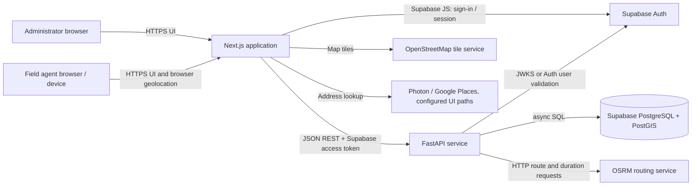

# FOS Agent — Technical Design and Technology Stack

**Document status:** Describes the implementation in this repository as inspected on 25 October 2026. It is an implementation overview, not a deployment runbook.

## 1. Purpose and scope

FOS Agent is a location-aware field operations application. Administrators manage agents, customers, scheduled visits, assignments, and routes. Agents use a mobile-oriented web portal to see assigned work, update visit status, and share their current location. The admin interface provides operational summaries, directories, maps, and route planning.

## 2. System context

The frontend is a separate application from the API. It calls the FastAPI JSON API using a typed client and sends the Supabase access token as a bearer token. The API verifies identity, loads the application profile and role from PostgreSQL, enforces role-specific access, and reads or writes operational data. Geospatial columns use SRID 4326.

## 3. Technology stack

| Area | Technologies used in the repository | Responsibility |
|---|---|---|
| Web application | Next.js 14 App Router, React 18, TypeScript 5 | Admin and field-agent pages, client-side interaction, routing, and typed UI code |
| Styling and UI | Tailwind CSS 3, PostCSS, Lucide React, `clsx`, `tailwind-merge` | Styling, icons, and conditional class composition |
| Browser authentication | `@supabase/supabase-js` 2 | Supabase sign-in and browser session management |
| Maps | Leaflet 1.9.4 loaded from unpkg CDN; OpenStreetMap tile layer | Interactive maps, markers, and route geometry display |
| Address lookup | Photon (Komoot) client and Google Maps Places loader/utilities | Address suggestions and geocoding flows where configured |
| API | Python, FastAPI, Uvicorn | Async REST endpoints, OpenAPI docs, CORS, and application lifecycle |
| Validation and settings | Pydantic 2, Pydantic Settings | Request/response schemas and environment-backed configuration |
| Persistence | SQLAlchemy 2 async ORM, asyncpg, GeoAlchemy2 | Async database access and PostGIS geometry mapping |
| Database and identity | Supabase PostgreSQL, PostGIS, Supabase Auth | Durable operational records, spatial types/indexes, and user identity |
| Schema migration | Alembic | Versioned database schema changes |
| Token verification | `python-jose[cryptography]`, `httpx` | JWT/JWKS verification and Supabase Auth API fallback |
| Routing | OSRM HTTP API | Driving duration matrix and road route geometry |
| Deployment definition | Render Blueprint (`render.yaml`); deployment guide documents Vercel frontend | Backend service configuration and frontend hosting instructions |
| Python quality/support dependencies | Pytest, pytest-asyncio, Gunicorn, python-dotenv | Automated tests, async test support, production server option, and local environment loading |

Although OR-Tools is present in `backend/requirements.txt`, the inspected route-planning endpoint currently requests an OSRM duration matrix and applies a nearest-next-stop greedy ordering in application code. OR-Tools is not imported by the route implementation. The frontend `routeOptimizer.ts` explicitly labels its Haversine-based result as a demo estimate; it is not the source of road routes.

## 4. Application architecture

### Frontend

The `frontend/src/app` tree contains App Router pages for the admin dashboard, agent operations, customers, assignments, routes, tracking, analytics, territories, and settings. Shared components provide maps, forms, dashboards, and agent visit flows. React contexts hold authentication and operational state. `frontend/src/lib/api.ts` centralizes API calls and bearer-token handling; `supabaseClient.ts` initializes the browser Supabase client using public environment configuration.

The maps load Leaflet and its CSS at runtime from the unpkg CDN. Map tiles and routing/geocoding providers are external services, so browser access to those services and valid provider configuration are required for their features.

### Backend

`backend/app/main.py` constructs the FastAPI application, configures CORS, attaches the API routers, exposes health checks, and disposes the async engine at shutdown. Versioned routes are grouped in `backend/app/api/v1`. SQLAlchemy models and Pydantic schemas separate persistence from API payload validation. Database access is provided through an async session dependency in `backend/app/db/session.py`.

The API is mounted under `/api/v1` and also under `/api` for compatibility. FastAPI OpenAPI and Swagger UI are configured under `/api/v1/openapi.json` and `/api/v1/docs`.

### Data model

Core SQLAlchemy entities include:

- **Profile:** application identity, role, and link to a Supabase Auth user.
- **Agent:** operational agent record linked to a profile; status, territory, contact/base details, current coordinates, location source, and battery metadata.
- **AgentLocation:** time-stamped agent GPS readings with spatial point and accuracy metadata.
- **Customer** and **Lead:** customer/contact records and prospect tracking, including geographic coordinates/points.
- **Visit:** scheduled customer work assigned to an agent, with status, time/date, and route ordering.
- **Assignment:** agent assignment records.
- **VisitLocationLog:** recorded location/check-in data associated with visit activity.

Spatial point columns use PostGIS geometry with SRID 4326 and spatial indexes. Alembic revisions under `backend/alembic/versions` are the schema history.

## 5. Main request flows

### Sign-in and authorization

1. The user signs in through Supabase Auth from the browser UI.
2. The frontend obtains the access token and sends it to protected API calls in `Authorization: Bearer ...`.
3. FastAPI validates the JWT using the project's JWKS for asymmetric keys or the configured secret for HS256. The code also has a remote Supabase Auth user lookup fallback.
4. The API resolves the token subject to a `Profile` row, including the linked agent record where applicable.
5. Route dependencies enforce administrator or agent access. Agent-scoped operations are limited to the authenticated agent; admin endpoints require an administrator profile.

### Agent location update

The agent portal obtains location through browser/device geolocation and submits coordinates to the authenticated location endpoint. The backend records the latest location and location metadata in the agent record/history model. Route planning checks that the latest GPS position is recent enough according to `LOCATION_STALE_THRESHOLD_SECONDS`.

### Route planning and dispatch

1. An administrator requests a route preview for an agent and date.
2. The API loads the agent's latest GPS record and active visits, checks location freshness, and requires coordinates for every customer destination.
3. When optimization is requested, the API asks OSRM for a driving-duration matrix. It keeps an in-progress visit at the front (when present), then repeatedly selects the remaining stop with the lowest duration from the current stop (greedy nearest-next selection).
4. The API asks OSRM for the road geometry and total distance/duration for the chosen sequence and returns the preview; preview does not persist the order.
5. A separate route-order request validates the submitted visit IDs against the current active visits and persists their `order_index`. The agent route view reads that order.

This is a heuristic route ordering strategy, not a global optimality guarantee, and the route preview depends on OSRM availability and coverage.

## 6. API capability areas

The v1 router includes health, authentication/provisioning, dashboard summary, agents, customers, visits/dispatch, and agent-specific operations. Representative flows include:

- Health and database diagnostics.
- Admin dashboard summary and agent directory/search.
- Admin creation/invitation and detail access for agents.
- Customer listing, detail, and updates.
- Visit scheduling/dispatch, listing, status changes, and route preview/order persistence.
- Agent dashboard, own profile/visits/history, duty state, location updates, and route views.
- Admin bootstrap for the first administrator, subsequent admin provisioning, and signup routes.

The generated OpenAPI specification is the authoritative detail for request and response shapes.

## 7. Security and configuration

- Identity is managed by Supabase Auth; operational roles are read from the application `profiles` table.
- The browser should receive only public Supabase configuration (project URL and anon key). Service-role credentials, JWT secrets, registration keys, and database URLs belong only in backend secrets.
- CORS origins and optional preview-origin regex are configured from backend settings.
- Database connections use asyncpg through SQLAlchemy and enable TLS for non-local database hosts.
- First-admin bootstrap is intended to work only while there are no administrator profiles; subsequent admin provisioning is role-protected.
- Environment templates are in `backend/.env.example` and `frontend/.env.example`; actual secret values must be supplied by the deployment environment.

## 8. Deployment shape

`render.yaml` defines the Python backend service rooted at `backend`, installs `requirements.txt`, starts Uvicorn, and configures `/health` as its health check. `DEPLOYMENT.md` documents a Vercel deployment for the Next.js frontend and Supabase for PostgreSQL/PostGIS and Auth. The backend needs its database, Supabase, CORS, and registration settings configured in the Render environment; the frontend needs public API and Supabase settings in Vercel.

Database changes are managed by Alembic. The deployment guide recommends applying migrations as a controlled deployment step rather than exposing migration execution as an operational public API.

## 9. Current implementation notes

- The repository contains both `visits.py` and agent-specific route handlers. Route preview uses OSRM from the backend; a separate frontend helper contains demo-only straight-line estimates.
- OSRM's public demo endpoint is configured as the default base URL in backend settings. A production deployment should deliberately configure/operate an appropriate routing service and observe its usage policy and availability.
- `requirements.txt` includes OR-Tools, but the current route endpoint does not use it.
- Google Places support is present in frontend utilities/components; Photon is also present. Select and configure the intended provider per environment, including required API keys and usage limits.
- The README's directory outline is a simplified snapshot and does not list every current page or model. This document reflects the current repository structure and inspected implementation.

## 10. Useful source locations

- `frontend/src/app/` — pages and route layouts.
- `frontend/src/components/` — shared UI, map, and field-agent components.
- `frontend/src/lib/api.ts` — API client and route geometry helpers.
- `backend/app/main.py` — FastAPI application setup.
- `backend/app/api/v1/` — API endpoints.
- `backend/app/models/` and `backend/app/schemas/` — persistence models and API schemas.
- `backend/app/core/auth.py` — token verification and profile/role resolution.
- `backend/app/db/session.py` — async SQLAlchemy engine and request sessions.
- `backend/alembic/versions/` — database migrations.
- `render.yaml` and `DEPLOYMENT.md` — deployment configuration and instructions.
